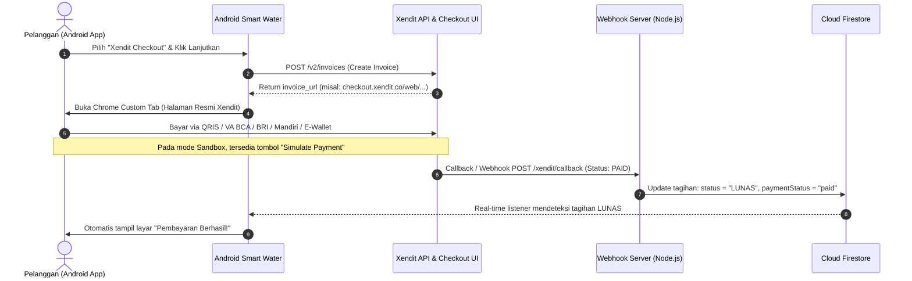

# Panduan Integrasi Xendit Payment Gateway (Smart Water PDAM)

Integrasi **Opsi 1: Xendit Checkout / Invoice** telah berhasil diimplementasikan di dalam aplikasi Smart Water.

---

## 1. Arsitektur & Cara Kerja



---

## 2. File-File yang Dibuat & Diperbarui

1. **Model & Service Xendit (Android)**:
   - [`XenditModels.kt`](file:///c:/Users/LENOVO/Downloads/smart-water/app/src/main/java/com/example/data/model/XenditModels.kt): Data class `XenditInvoiceRequest` & `XenditInvoiceResponse`.
   - [`XenditService.kt`](file:///c:/Users/LENOVO/Downloads/smart-water/app/src/main/java/com/example/data/service/XenditService.kt): Service HTTP OkHttp untuk endpoint `POST /v2/invoices`, `GET /v2/invoices/{id}`, dan endpoint simulasi sandbox.
   - [`Bill.kt`](file:///c:/Users/LENOVO/Downloads/smart-water/app/src/main/java/com/example/data/model/Bill.kt): Ditambahkan field `invoiceUrl` dan `xenditInvoiceId`.

2. **Repository & ViewModel (Android)**:
   - [`BillRepository.kt`](file:///c:/Users/LENOVO/Downloads/smart-water/app/src/main/java/com/example/data/repository/BillRepository.kt): Fungsi `createXenditInvoice(...)`, `checkXenditInvoiceStatus(...)`, dan `simulateXenditPayment(...)`.
   - [`BillViewModel.kt`](file:///c:/Users/LENOVO/Downloads/smart-water/app/src/main/java/com/example/ui/viewmodel/BillViewModel.kt): State manajemen `XenditState` (Loading, Created, Paid, Error).

3. **User Interface (Jetpack Compose)**:
   - [`PaymentMethodScreen.kt`](file:///c:/Users/LENOVO/Downloads/smart-water/app/src/main/java/com/example/ui/screens/PaymentMethodScreen.kt): Menu **Xendit Checkout** sebagai opsi rekomendasi utama dengan badge keamanan resmi Bank Indonesia.
   - [`PaymentInstructionScreen.kt`](file:///c:/Users/LENOVO/Downloads/smart-water/app/src/main/java/com/example/ui/screens/PaymentInstructionScreen.kt): Kartu Checkout Xendit aktif, tombol "Buka Halaman Checkout Xendit", tombol "Cek Status Pembayaran (Xendit)", dan tombol "Simulasi Bayar Sandbox (Test Mode)".
   - [`MainActivity.kt`](file:///c:/Users/LENOVO/Downloads/smart-water/app/src/main/java/com/example/MainActivity.kt): Helper pembuka Chrome Custom Tabs & deep-link listener.
   - [`AndroidManifest.xml`](file:///c:/Users/LENOVO/Downloads/smart-water/app/src/main/AndroidManifest.xml): Deep link intent filter `smartwater://payment-return`.

4. **Backend Webhook Server**:
   - [`backend/xendit-server.js`](file:///c:/Users/LENOVO/Downloads/smart-water/backend/xendit-server.js): Server Express.js untuk menerima callback Webhook Xendit dan otomatis mengupdate status di Firestore & saldo dompet operator.
   - [`backend/package.json`](file:///c:/Users/LENOVO/Downloads/smart-water/backend/package.json): Konfigurasi dependensi Node.js.

5. **Web Admin Dashboard**:
   - [`web-admin/index.html`](file:///c:/Users/LENOVO/Downloads/smart-water/web-admin/index.html): Ditambahkan indikator badge **Xendit Gateway: Aktif** pada header dashboard.

---

## 3. Langkah Pengujian Sandbox (Testing Tanpa Uang Asli)

### Cara 1: Menggunakan Tombol Simulasi Langsung di Aplikasi
1. Buka aplikasi Smart Water, masuk ke menu **Tagihan** -> klik **Bayar Sekarang**.
2. Pilih metode **Xendit Checkout (Rekomendasi)** -> klik **Lanjut ke Pembayaran Xendit**.
3. Pada halaman instruksi, Anda dapat langsung mengklik tombol **Simulasi Bayar Sandbox (Test Mode)**.
4. Tagihan seketika akan terverifikasi lunas dan berpindah ke layar **Pembayaran Berhasil!**.

### Cara 2: Menggunakan Halaman Checkout Resmi Xendit
1. Klik **Buka Halaman Checkout Xendit**.
2. Chrome Custom Tab akan membuka halaman checkout Xendit resmi (menampilkan opsi QRIS, BCA, BRI, Mandiri, BNI, OVO, DANA, Alfamart/Indomaret).
3. Di bagian atas halaman checkout Sandbox Xendit, terdapat banner kuning untuk simulasi bayar (misal "Simulate payment with QRIS / Virtual Account").
4. Klik simulasi tersebut, lalu kembali ke aplikasi.
5. Klik **Cek Status Pembayaran (Xendit)**, dan status tagihan akan otomatis terupdate menjadi Lunas.

---

## 4. Cara Menghubungkan API Key Xendit Anda Sendiri

Jika Anda sudah mendaftar di [dashboard.xendit.co](https://dashboard.xendit.co/register):

1. Masuk ke Dashboard Xendit -> **Settings** -> **API Keys**.
2. Buat **Secret Key** baru (berawalan `xnd_development_...` untuk Sandbox atau `xnd_production_...` untuk Live). Berikan permission `Money-in: WRITE`.
3. Masukkan API Key tersebut ke dalam file [`XenditService.kt`](file:///c:/Users/LENOVO/Downloads/smart-water/app/src/main/java/com/example/data/service/XenditService.kt):
   ```kotlin
   var apiKey: String = "xnd_development_API_KEY_ANDA_DISINI"
   ```
4. Untuk Webhook di [`backend/xendit-server.js`](file:///c:/Users/LENOVO/Downloads/smart-water/backend/xendit-server.js), daftarkan URL callback di menu **Settings > Callbacks > Invoices: Paid** dengan URL endpoint server Anda (`https://domain-anda.com/xendit/callback`).
